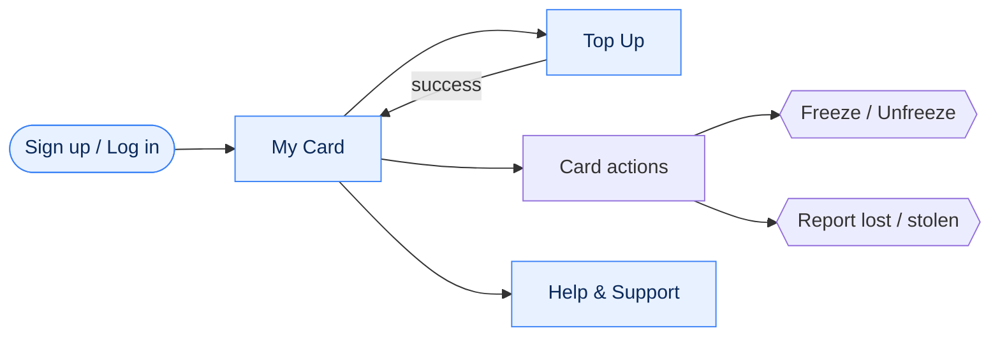
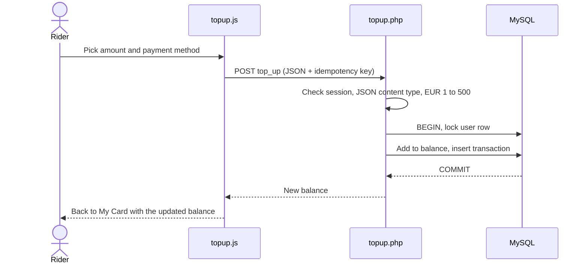
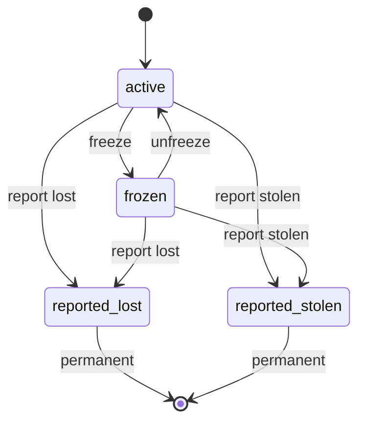
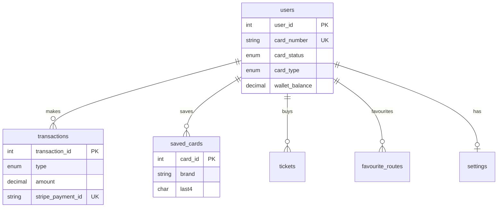

<div align="center">


# Hop App

**A friendlier alternative to the Leap Card.**
Check your balance, top up in a few taps, and freeze or report a lost card, all in one place.

[](https://github.com/DamoMcN/HopApp/actions/workflows/playwright.yml)


*Built for the Project Management module at ATU Galway.*

[Quick start](#quick-start) · [Features](#features) · [How it works](#how-it-works) · [Roadmap](#roadmap) · [Contributing](#contributing)

</div>

---

## Contents

- [About](#about)
- [Features](#features)
- [Quick start](#quick-start)
- [How it works](#how-it-works)
- [Project structure](#project-structure)
- [Testing](#testing)
- [Help, FAQ and troubleshooting](#help-faq-and-troubleshooting)
- [Roadmap](#roadmap)
- [Contributing](#contributing)

---

## About

Hop is a student-built take on the Leap Card. The goal is to improve the overall system and UI design while adding useful features that the existing experience lacks.

> [!IMPORTANT]
> **Payments run in demo mode.** No real payment provider is contacted and no real money moves. See [Payments in demo mode](#payments-in-demo-mode).

## Features

| | Feature | What you can do |
| :-: | --- | --- |
| 🔐 | **Sign up and log in** | Friendly pop-ups explain any mistake and point to the field to fix. The sign-up form recommends a card type from your age and student status. |
| 💳 | **Your Hop card** | See your 8-digit card number, live balance and recent transactions on a card face. |
| 👆 | **Card actions** | Press the card to open a drop-down: **Freeze / Unfreeze**, **Report lost**, **Report stolen**. |
| ➕ | **Top up** | Use the circular dial (EUR 5 to EUR 100 in steps of EUR 5), a saved card, or the demo wallet. |
| 🗺️ | **Bus map** | A light purple map of Irish bus routes and stops with two tabs. **Route view**: pick a region and route, choose From and To stops, and see live buses (needs the live proxy). **Buy a ticket**: search any two stops, see the buses that go between them, pick one and continue to the Tickets page with the journey ready. |
| 🧭 | **Bottom navigation bar** | Switch between Card, Map and Tickets (Top Up and Help stay in the menu). Built so the tabs and start-up page can be customised per user later. |
| ❓ | **Help and support** | Searchable, collapsible FAQ sections and a Contact Support page that flips in. |

<details>
<summary><b>🔐 Sign up and log in: more detail</b></summary>

- Eligibility logic for **Child, Young Adult, Student, Adult** and **Free Travel** cards.
- One reusable `showNotice()` pop-up replaces browser `alert()` boxes. It explains the problem in plain English, outlines and focuses the field to fix, and lists exactly which password rules are missing.
- A live "passwords match" hint appears under **Confirm Password**.
- Handles wrong login details, an already-registered email, bad dates of birth, network failures and server errors.

</details>

<details>
<summary><b>💳 Card page: more detail</b></summary>

- Frozen, lost and stolen cards show a status veil, and the menu adapts to the card's state.
- The balance refreshes whenever the page is shown, including when you return with the browser back button.

</details>

<details>
<summary><b>➕ Top up: more detail</b></summary>

- The dial works by **dragging, tapping or using the arrow keys**.
- **Add demo card** stores only a card brand and the last 4 digits, never a full card number.
- **Pay with wallet (demo)** is a clearly labelled simulated wallet sheet. It deliberately does not copy Apple Pay or Google Pay branding.
- Every top-up attempt carries an **idempotency key**, so a retry after a dropped connection can never credit the money twice.
- After a successful top up you are taken back to your card, where the new balance is shown.

</details>

<details>
<summary><b>❓ Help and support: more detail</b></summary>

- Sections: Login & Sign up, Top Up, My Card, Lost or stolen cards.
- The search box looks through section names, questions and answers, and opens matches automatically.
- To add questions, edit the `faqSections` list at the top of `frontend/support/support.js`.

</details>

<details>
<summary><b>🗺️ Bus map and navigation bar: more detail</b></summary>

- The base map is Esri's light grey map, re-coloured purple with an SVG filter in `map.html` (change the `tableValues` there to adjust the colours). Route, stop and bus colours are CSS variables at the top of `map.css`.
- Choose a region, filter operators (TFI / Public, Citylink), pick a route, then type a **From** and **To** stop. The stops between them stay solid and the rest fade.
- The route finder is a bottom sheet you can collapse with its handle.
- **Background loading:** `frontend/shared/js/prefetch.js` quietly downloads the map data in stages: the route list and small regions on the login/sign-up pages, the bigger regions on the card page after login, and the rest when the map opens. It only fills the browser cache, waits until the page has loaded, and does nothing on Data Saver or 2G.
- **Navigation bar:** `frontend/shared/js/navbar.js` lists every possible tab once (`TABS`) and builds the bar from a config: `{ tabs: ['card', 'map', 'tickets'], startPage: 'card' }`. Today everyone gets `DEFAULT_CONFIG`. Later a settings page can save a per-user config (the `settings` table already has `navbar_layout` and `default_tab`) and call `HopNav.init(config)`. Bad or old configs are cleaned up automatically (2 to 5 tabs, known pages only).
- To add a page to the app, add one entry to `TABS`, then put `data-nav="your-tab-id"` on that page's `<body>`.

</details>

### Payments in demo mode

`PAYMENTS_MODE` in `backend/auth/topup.php` is set to `'mock'`. `charge_payment()` is the single place where a real provider (for example Stripe in test mode) would be added later.

<!--
SCREENSHOTS: add images to docs/screenshots/ and uncomment this block.

### Screenshots

| Log in | Your card | Top up | Help |
| :-: | :-: | :-: | :-: |
|  |  |  |  |
-->

---

## Quick start

You need [WampServer](https://www.wampserver.com/en/) (Apache, PHP and MySQL). Node.js is only needed to run the tests.

<details open>
<summary><b>1. Get the code</b></summary>

Clone the repo into WampServer's web folder:

```bash
cd C:\wamp64\www
git clone https://github.com/DamoMcN/HopApp.git
```

</details>

<details open>
<summary><b>2. Set up the database</b></summary>

1. Start WampServer and open **phpMyAdmin**.
2. Create a database called `hop_app_db`.
3. Open the **Import** tab and import `database/hop_app_db.sql`.

The app connects as `root` with no password on `localhost`. To change that, edit `backend/db_connect.php`: every PHP endpoint gets its connection from that one file.

> [!WARNING]
> `hop_app_db.sql` **drops and recreates tables**. Do not import it into a database that holds data you want to keep.

</details>

<details open>
<summary><b>3. Open the app</b></summary>

Go to **http://localhost/HopApp/frontend/auth/index.html**, create an account, and you are in.

> [!NOTE]
> The card, top-up and card-action features live on the `feature/card` branch until it is merged into `main`. If you cloned `main` and don't see them, run `git checkout feature/card`.

</details>

<details>
<summary><b>4. (Optional) Set up the bus map data and live buses</b></summary>

The map needs a route file that is too big for git (about 90 MB), so it is not in the repo.

1. Build `routes.geojson` with `convert.js` from the GTFS files (agency, routes, shapes, stops, stop_times, trips).
2. Put it at `frontend/map/data/routes.geojson`. That folder is git-ignored.
3. From `frontend/map/`, run `node build-data.js`. It splits the big file into a small `index.json` (loaded first) and one `geo-<region>.json` per region (loaded when that region is picked). Run it again whenever `routes.geojson` changes. The map reads only these split files.
4. For **live buses**, run the proxy (Node 20.6 or newer):
   ```bash
   cd backend/live
   npm install
   cp .env.example .env     # then add your National Transport Authority API key
   npm start
   ```
   The map works without it. It just shows "Live bus positions are not available".

> [!WARNING]
> Never put the API key in the code or commit `.env`. The key lives only in `backend/live/.env`.

</details>

<details>
<summary><b>Already have a <code>hop_app_db</code> from an earlier branch?</b></summary>

Don't import the full dump. In phpMyAdmin (SQL tab), run these **once, in this order**:

1. `database/topup_migration.sql`
2. `database/card_reports_migration.sql`

> [!CAUTION]
> Skipping the second one means **Report stolen / Report lost will fail**.

</details>

---

## How it works

### The app at a glance



### Life of a top up



If the connection drops and the request is retried, the unique payment reference on `transactions` stops the same top up from being credited twice.

### Card states



Reported cards are permanently blocked and need Contact Support.

### Database



`tickets`, `favourite_routes` and `settings` are in the schema ready for upcoming features.

<details>
<summary><b>🛡️ Server-side rules worth knowing</b></summary>

- After log-in, the user always comes from the **session**, never from the request.
- The top-up and card-action endpoints (`topup.php`, `card_status.php`) only accept requests with a JSON `Content-Type`, a simple CSRF guard. Sign-up and log-in use normal form posts.
- Balance changes run in a **database transaction with a row lock**.
- Passwords are hashed, and login uses one message for both "no such email" and "wrong password".
- Database and other technical errors are written to the PHP error log. The person using the app only sees a friendly message.
- All endpoints share one database connection (`backend/db_connect.php`), so credentials live in a single place.

</details>

---

## Project structure

```text
HopApp/
├── frontend/
│   ├── auth/       Login, sign-up, eligibility logic, friendly pop-ups
│   ├── card/       Card page (the app home) and card actions
│   ├── topup/      Dial slider, saved cards, demo wallet
│   ├── map/        Bus map, route finder, live buses
│   ├── tickets/    Tickets page (shows the journey picked on the map)
│   ├── support/    Searchable FAQ and Contact Support
│   └── shared/     Design system: main.css, menu.js, navbar, images
├── backend/
│   ├── db_connect.php
│   ├── auth/       PHP endpoints (see below)
│   └── live/       Node proxy for live bus positions
├── database/       Schema and migrations
├── tests/          Playwright tests
└── .github/workflows/playwright.yml   CI
```

<details>
<summary><b>Frontend files</b></summary>

| Folder | Files | Purpose |
| --- | --- | --- |
| `frontend/shared/` | `css/main.css`, `css/navbar.css`, `js/menu.js`, `js/navbar.js`, `img/` | Global CSS variables, base resets, buttons, page header and slide-out menu. `menu.js` builds the hamburger menu: **My Card**, **Map**, **Tickets**, **Top Up**, **Help & Support**, **Log Out**. `navbar.js` builds the bottom navigation bar. Images are small `.webp` versions of the original PNGs, which are kept for reference. |
| `frontend/auth/` | `index.html`, `signup.html`, `auth.css`, `auth.js`, `logout.php` | Login page, account creation with an eligibility modal, form validation and notices. `logout.php` ends the session. |
| `frontend/card/` | `card.html`, `card.css`, `card.js` | Card face, transactions list and the card actions drop-down. |
| `frontend/topup/` | `topup.html`, `topup.css`, `topup.js` | Circular dial, saved-card list, **Add demo card**, demo wallet sheet. |
| `frontend/map/` | `map.html`, `map.css`, `map.js`, `data/` (git-ignored) | Light purple Leaflet map, route finder sheet, live bus markers. |
| `frontend/tickets/` | `tickets.html`, `tickets.css`, `tickets.js` | Shows the journey picked on the map's **Buy a ticket** tab (saved in `sessionStorage` as `hop.ticketDraft` and re-checked before display). The Buy button is disabled until ticket buying is built; with no journey it shows a "coming soon" message. |
| `frontend/support/` | `support.html`, `support.css`, `support.js` | Accordion FAQ, search, Contact Support. |

</details>

<details>
<summary><b>Backend endpoints (<code>backend/auth/</code>)</b></summary>

All of these get their database connection from `backend/db_connect.php`.

| File | Purpose |
| --- | --- |
| `signup.php` | Validates input (including that the confirm password matches), hashes the password, checks for an existing email, generates a unique 8-digit card number and creates the user. |
| `login.php` | Verifies credentials and starts the session. |
| `session.php` | Returns the logged-in user's details and wallet balance. |
| `transactions.php` | Returns the logged-in user's recent transactions. |
| `topup.php` | `GET` returns balance and saved cards. `POST` (JSON) supports `add_card` and `top_up` with strict validation (EUR 1 to EUR 500 server limit, idempotency key, active cards only). |
| `card_status.php` | `POST` (JSON) with `freeze`, `unfreeze`, `report_lost` or `report_stolen`. |

</details>

<details>
<summary><b>Database files</b></summary>

| File | Purpose |
| --- | --- |
| `hop_app_db.sql` | Full schema, including `saved_cards`, the unique payment reference on `transactions` and the card status values. |
| `topup_migration.sql` | Adds the `saved_cards` table and a unique key on `transactions.stripe_payment_id`. |
| `card_reports_migration.sql` | Adds the `reported_lost` and `reported_stolen` card statuses. |

</details>

---

## Testing

Automated tests use [Playwright](https://playwright.dev/) and cover page loading, required fields, validation and card eligibility rules. They run on every push and pull request through GitHub Actions (see the badge at the top).

```bash
npm ci
npx playwright install chromium
npm test
```

Tests serve the static frontend with `http-server`, so **PHP and MySQL are not needed** to run them. After a run, open the report with `npx playwright show-report`.

---

## Help, FAQ and troubleshooting

<details>
<summary><b>Report lost / Report stolen fails</b></summary>

You probably haven't run `database/card_reports_migration.sql`. See [Already have a hop_app_db](#quick-start).

</details>

<details>
<summary><b>"Database connection failed"</b></summary>

Check that WampServer is running (green icon), that `hop_app_db` exists, and that the credentials in `backend/db_connect.php` match your MySQL setup.

</details>

<details>
<summary><b>The page loads but login or balance does nothing</b></summary>

Open the app through WampServer (`http://localhost/HopApp/...`), not by double-clicking the HTML file. The PHP endpoints only run when served by Apache.

</details>

<details>
<summary><b>Can I use real money or a real card?</b></summary>

No. Payments are demo only and no full card numbers are ever stored.

</details>

<details>
<summary><b>I forgot my password</b></summary>

Password reset isn't built yet. **Forgot your password?** currently shows a "coming soon" pop-up.

</details>

### Known limitations

- The largest region file (`geo-other-national.json`) is about 9 MB, so "All of Ireland" and national routes still take a moment on mobile data. The map's first load is only the 2 MB `index.json`.
- Live buses need the Node proxy running, and it only works on the same machine or network unless it is hosted.
- The navigation bar and start-up page are not yet editable in the app. They use the defaults.
- Password reset is not built yet.
- Replacement cards are not available in the app. The FAQ directs people to Contact Support.
- Payments are demo only.
- Future ticket purchases must check `card_status = 'active'` on the server.

---

## Roadmap

- [x] Sign-up and log in with validation and hashed passwords
- [x] Card page with balance and transactions
- [x] Top up with dial, saved cards and demo wallet
- [x] Freeze, unfreeze, report lost and report stolen
- [x] Searchable help and support
- [x] Automated Playwright tests in CI
- [ ] Password reset by email
- [x] Bus map with routes, stops and live buses (Leaflet)
- [x] Bottom navigation bar
- [ ] Choose your own tabs and start-up page
- [x] Split map data per region so it loads faster

Have an idea? [Open an issue](https://github.com/DamoMcN/HopApp/issues/new).

---

## Contributing

1. Create a branch from `main`, for example `feature/your-feature`.
2. Make your changes and run `npm test`.
3. Open a pull request. CI will run the tests automatically.

Found a bug? [Report it here](https://github.com/DamoMcN/HopApp/issues).

<div align="center">

Made with 🐰 at ATU Galway

</div>
