<div align="center">


# Hop App

**A Leap Card alternative with a friendlier design and a live bus map.**
Built for our Project Management module at ATU Galway.


[Screens](#-the-screens) ·
[Quick start](#-quick-start) ·
[User flows](#-user-flows) ·
[How it fits together](#-how-it-fits-together) ·
[Features](#-features) ·
[Bus map](#-bus-map-and-live-buses) ·
[Project structure](#-project-structure) ·
[Roadmap](#-roadmap)

</div>

---

## 📱 The screens

Design previews of the main screens, drawn in the app's own colours. Tap any screen to see how it works in the flows below.

<table>
  <tr>
    <td align="center">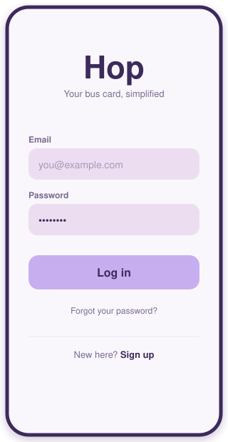<br><b>Log in</b><br><sub>Friendly pop-ups for every mistake</sub></td>
    <td align="center">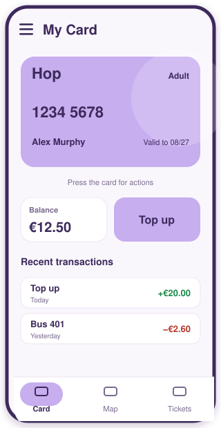<br><b>My Card</b><br><sub>Live balance, expiry, recent trips</sub></td>
    <td align="center">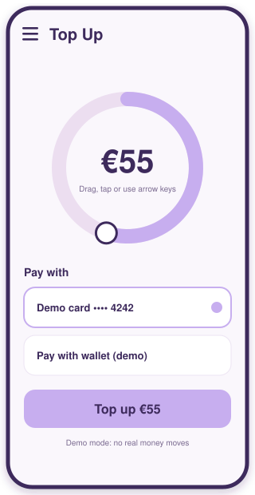<br><b>Top Up</b><br><sub>Circular dial, €5 to €100</sub></td>
  </tr>
  <tr>
    <td align="center">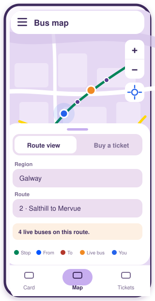<br><b>Route view</b><br><sub>Routes, live buses, your location</sub></td>
    <td align="center">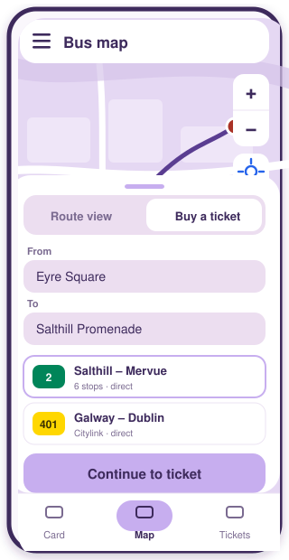<br><b>Buy a ticket</b><br><sub>Pick From and To, choose a bus</sub></td>
    <td align="center">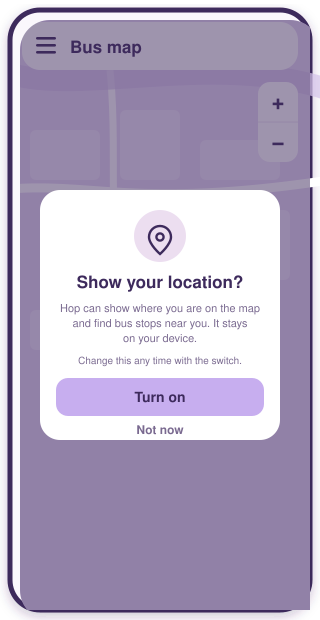<br><b>My location</b><br><sub>Asked once, off until you say yes</sub></td>
  </tr>
</table>

<details>
<summary><b>🎨 Colour palette</b> (click to open)</summary>

<br>

| Used for | Colour | Value |
| --- | --- | --- |
| Primary (buttons, card) |  | `#c7aeef` |
| Surface (inputs, panels) |  | `#ecdef0` |
| Text and card ink |  | `#3d2a5c` |
| TFI / public bus routes |  | `#008559` |
| Citylink routes |  | `#ffd700` |
| Live buses |  | `#f08a24` |
| You (location) |  | `#2563eb` |

Hop's own screens are purple. Bus companies keep their own colours on the map because they are separate from Hop. Shared colours live in `frontend/shared/css/main.css`, map colours at the top of `frontend/map/map.css`.

</details>

---

## 🚀 Quick start

You need **WampServer** (PHP and MySQL) and a browser. Node.js is only needed for the tests and for rebuilding map data.

<details open>
<summary><b>1. Put the project in WAMP</b></summary>

<br>

Clone or copy the repo to `C:\wamp64\www\HopApp`, start WAMP, and open:

```
http://localhost/HopApp/frontend/auth/index.html
```

</details>

<details>
<summary><b>2. Set up the database</b></summary>

<br>

**Fresh install:** in phpMyAdmin create a database called `hop_app_db`, then import `database/hop_app_db.sql`.

> ⚠️ Do **not** import that file into a database you already use. It drops and recreates tables.

**Already have a `hop_app_db`?** Run these once in phpMyAdmin (SQL tab), in order, instead of importing:

| # | File | If you skip it |
| --- | --- | --- |
| 1 | `database/topup_migration.sql` | Top up and saved cards fail |
| 2 | `database/card_reports_migration.sql` | **Report lost / stolen** fails |
| 3 | `database/card_expiry_migration.sql` | **Logging in bounces you straight back to the login page** |
| 4 | `database/saved_cards_migration.sql` | Saving your own card fails |
| 5 | `database/recurring_topups_migration.sql` | Recurring top ups fail |

</details>

<details>
<summary><b>3. Live buses (nothing to set up)</b></summary>

<br>

Live positions come from our hosted server, so there is **no key and no setup** for the team. Pick one route on the map and buses appear. The first request after a quiet spell can be slow while the free server wakes up. Details in [Bus map and live buses](#-bus-map-and-live-buses).

</details>

<details>
<summary><b>4. Run the tests</b></summary>

<br>

```bash
npm install
npx playwright install     # first time only
npx playwright test
```

</details>

---

## 🧭 User flows

Click a flow to open it. These are drawn with Mermaid, which GitHub renders for you.

<details open>
<summary><b>Sign up and log in</b></summary>

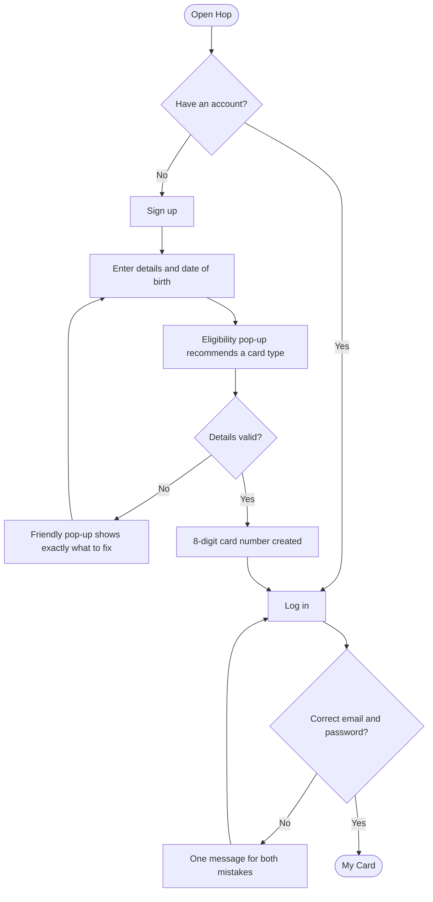

</details>

<details>
<summary><b>See your card and top up</b></summary>

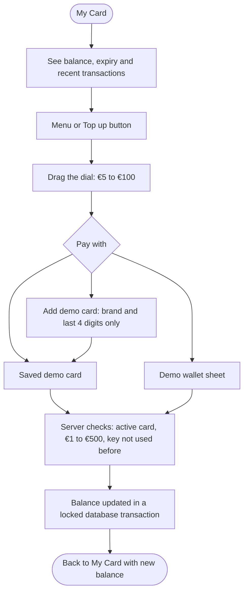

A dropped connection and a retry can never credit the money twice, because every attempt carries a one-time idempotency key.

</details>

<details>
<summary><b>Card actions</b></summary>

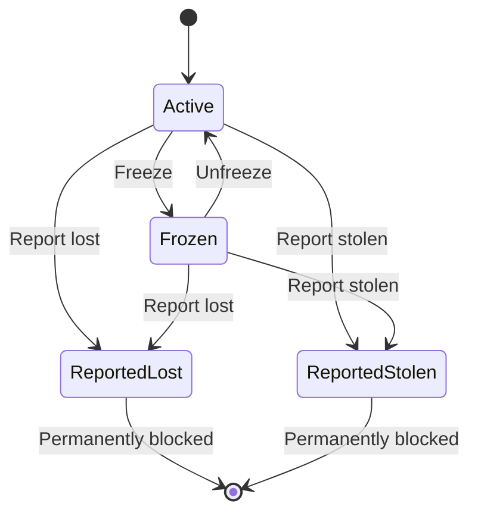

Press the card to open the actions. Frozen, lost and stolen cards show a status veil, and the menu adapts to the card's state.

</details>

<details>
<summary><b>Plan a journey and buy a ticket</b></summary>

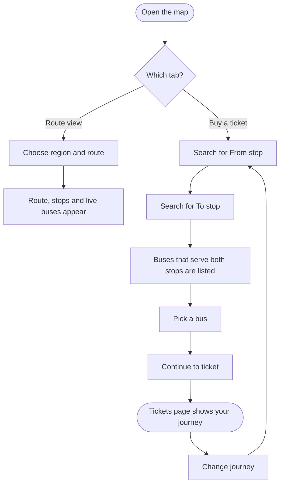

The chosen journey is handed to the Tickets page and is checked again there before it is shown. Buying is not built yet.

</details>

<details>
<summary><b>My location (always optional)</b></summary>

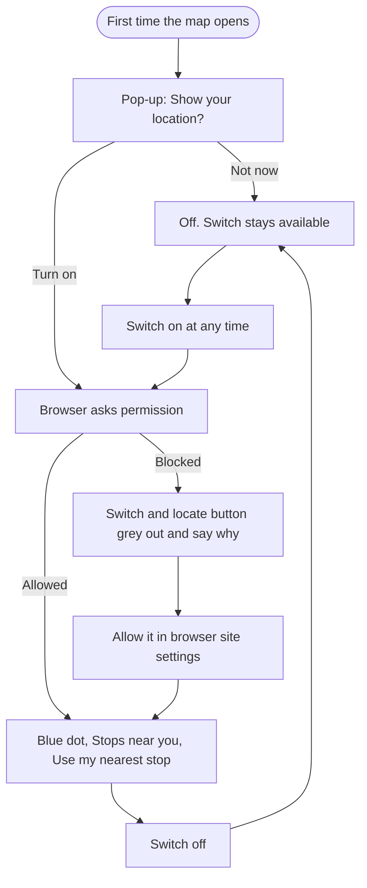

If the browser blocks location, everything that needs it is hidden. Change your mind in the browser's site settings and the map reacts straight away. Your position stays in your browser and is never sent to our servers.

</details>

---

## 🧩 How it fits together

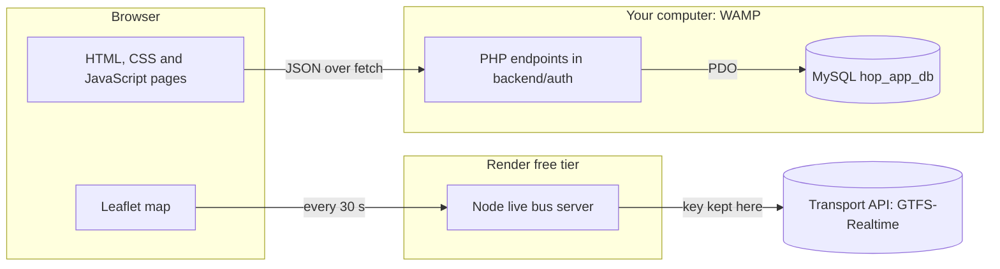

- The **logged-in user always comes from the session**, never from the request.
- State-changing endpoints require a JSON `Content-Type` (a simple CSRF guard).
- Balance changes run in a database transaction with a row lock.
- Technical errors go to the PHP error log, never to the person using the app.
- The transport API key lives only on the live server, never in this repo.

---

## ✨ Features

| | Feature | Where |
| --- | --- | --- |
| ✅ | Sign up with age-based card recommendation, login with friendly errors | `frontend/auth/` |
| ✅ | Card with 8-digit number, live balance, expiry date, transactions | `frontend/card/` |
| ✅ | Freeze, unfreeze, report lost or stolen | `frontend/card/`, `card_status.php` |
| ✅ | Top up with a circular dial, saved demo cards, demo wallet | `frontend/topup/` |
| ✅ | Help and Support with searchable FAQ | `frontend/support/` |
| ✅ | Bus map with region and route picker | `frontend/map/` |
| ✅ | Buy a ticket journey planner (From, To, choose a bus) | `frontend/map/`, `frontend/tickets/` |
| ✅ | Live bus positions | `backend/live/` |
| ✅ | Optional My location with nearby stops | `frontend/map/` |
| ✅ | Tap a stop: buses that stop there, next arrivals and delays (needs the hosted live server) | `frontend/map/`, `backend/live/` |
| ✅ | Search routes by number or name, including city buses (Galway 401 to 412, Cork, Limerick, Waterford) | `frontend/map/` |
| 🚧 | Actually buying a ticket | Coming soon |
| 🚧 | Password reset | "Coming soon" pop-up for now |

> **Payments are in demo mode.** `PAYMENTS_MODE` in `backend/auth/topup.php` is `'mock'`. No real payment provider is contacted and no real money moves. "Add demo card" stores only a brand and the last 4 digits, never a full card number. `charge_payment()` is the single place a real provider (for example Stripe in test mode) would be added later.

---

## 🚌 Bus map and live buses

<details open>
<summary><b>Route data</b></summary>

<br>

The split route files in `frontend/map/data/` (`index.json` and `geo-*.json`) are committed, so routes work straight after pulling. Route lines load per region as you need them, and some data is fetched quietly in the background while you log in.

Only the huge source file `routes.geojson` stays out of git. To rebuild the split files, put it in `frontend/map/data/` and run `node build-data.js` from `frontend/map/`.

</details>

<details>
<summary><b>Live buses (hosted, no setup for the team)</b></summary>

<br>

Live positions come from a small Node server hosted free on Render at `https://hopapp.onrender.com/api/vehicles`. The same server answers `/api/stop-times?stop_id=…` with the next buses and delays at one stop, read from the transport API's trip-updates feed. The PHP copy on WAMP does not have stop times. It holds the transport API key so nobody else needs one. `map.js` points at it through `HOSTED_LIVE_URL`. Pick one route and buses appear, refreshing every 30 seconds.

- **It sleeps.** Render's free tier sleeps after about 15 minutes idle. The first request afterwards can take around a minute, so the map may say "Live bus positions are not available right now". Wait a minute and pick the route again.
- **Render settings.** Root directory `backend/live`, build command `npm install`, start command `node server.js`, Free plan. Environment variables: `NTA_API_KEY` (your National Transport Authority key) and `ALLOWED_ORIGINS` (sites allowed to call it, for example `http://localhost`).
- **Branch.** Render deploys from a chosen branch. After `feature/map` is merged, switch it to `main` in Settings, Build & Deploy.
- **🔒 Never commit or paste the API key.** It only goes in Render's environment variables, or in a git-ignored `.env` or `backend/live/config.local.php` for local use.

</details>

<details>
<summary><b>Run the live server yourself (optional)</b></summary>

<br>

**PHP on WAMP:** set `HOSTED_LIVE_URL` in `map.js` to an empty string, then copy `backend/live/config.local.php.example` to `backend/live/config.local.php` and add your key. Failures are logged to `backend/live/live-error.log`.

**Node locally:** in `backend/live/` copy `.env.example` to `.env`, add your key, run `npm install` then `node server.js`, and set `LIVE_URL` in `map.js` to `http://localhost:3000/api/vehicles`.

</details>

<details>
<summary><b>My location</b></summary>

<br>

The first time the map opens it asks whether to show your location. After that:

- The **My location** switch in the sheet turns it on or off at any time.
- A round **locate button** under the zoom buttons recentres on you.
- When on you get a **blue dot**, a **Stops near you** list (Route view) and a **Use my nearest stop** button (Buy a ticket).
- If the browser blocks location, the switch and button grey out and say why.
- Browsers only allow location on `https://` or `http://localhost`, so it will not work over a plain `http://` address on your network.

</details>

---

## 📁 Project structure

<details>
<summary><b>Folders at a glance</b></summary>

```
HopApp/
├── frontend/
│   ├── shared/     Design system: main.css, navbar, menu, prefetch, images
│   ├── auth/       Login and sign up
│   ├── card/       My Card (the app home)
│   ├── topup/      Top Up dial and saved cards
│   ├── map/        Bus map, journey planner, live buses, location
│   ├── tickets/    Shows the journey chosen on the map
│   └── support/    Help and Support FAQ
├── backend/
│   ├── auth/       PHP: signup, login, session, card, top up, transactions
│   ├── live/       Live bus servers (Node hosted, PHP alternative)
│   └── db_connect.php
├── database/       Schema and migrations
├── docs/screens/   Screen previews used in this README
└── tests/          Playwright tests
```

</details>

<details>
<summary><b>Backend endpoints</b></summary>

<br>

| File | What it does |
| --- | --- |
| `signup.php` | Validates input, hashes the password, checks for an existing email, creates a unique 8-digit card number and the user |
| `login.php` | Verifies credentials and starts the session. One message for "no such email" and "wrong password" |
| `session.php` | Returns the logged-in user's details, card expiry and wallet balance |
| `transactions.php` | Recent transactions for the logged-in user |
| `topup.php` | `GET` balance and saved cards. `POST` (JSON) `add_card` and `top_up` with strict validation (€1 to €500, idempotency key, active cards only) |
| `card_status.php` | `POST` (JSON) `freeze`, `unfreeze`, `report_lost`, `report_stolen`. Reported cards are permanently blocked |
| `logout.php` | Ends the session |

</details>

<details>
<summary><b>Frontend modules</b></summary>

<br>

- **`frontend/shared/`**: `css/main.css` (variables, resets, forms, buttons, header, slide-out menu), `js/menu.js` (hamburger menu), `js/navbar.js` (bottom navigation), `js/prefetch.js` (quiet background loading), `img/` (optimised `.webp` images, `.png` originals kept).
- **`frontend/auth/`**: login and sign up with an eligibility pop-up (Child, Young Adult, Student, Adult, Free Travel), one reusable `showNotice()` pop-up instead of browser alerts, and a live "passwords match" hint.
- **`frontend/card/`**: card face, balance, transactions, status veil and the actions drop-down. Refreshes the balance whenever the page is shown.
- **`frontend/topup/`**: circular dial (drag, tap or arrow keys), saved cards, "Add demo card", demo wallet sheet.
- **`frontend/support/`**: accordion FAQ with search. To add questions edit the `faqSections` list at the top of `support.js`.
- **`frontend/map/`**: `map.js` (Leaflet map, route and stop search, bus finder, stop card, live buses, location), `build-data.js` (builds the per-region data files and files city buses under their city).
- **`frontend/tickets/`**: shows the validated journey with Change journey and Clear.

</details>

---

## 🛣️ Roadmap

- [x] Authentication and card experience
- [x] Top up (demo mode), card freeze and reporting
- [x] Bus map with route data for all of Ireland
- [x] Journey planner and Tickets hand-off
- [x] Live buses and optional My location
- [x] Stop card with next buses and delays
- [ ] Buy the ticket you planned (server must check `card_status = 'active'`)
- [ ] Password reset
- [ ] Replacement cards in the app (the FAQ points to Contact Support for now)
- [ ] Regenerate the transport API key and keep it only in Render's environment variables

---

<div align="center">

Made at ATU Galway · Payments are demo only · Please never commit API keys

</div>
